# Wish Farm

Wish Farm is a planner for the money left over after your bills. You give it a list of things you want, in order (a Mac mini, a fishing boat, a trip to Japan, an emergency fund), and it works out, payday by payday, what to put toward each one and when each one is paid for. If you use YNAB, it keeps your YNAB targets in step with that plan, hour by hour.

**[Click through the slideshow →](https://blog.shanekeulen.com/wish-farm-demo/)**

Wish Farm isn't open source yet. This repo shows how it works and what it looks like, using five made-up people who each earn around $100,000 a year.

## Why it exists

YNAB is great at "every dollar has a job". It's not great at a *queue* of wishes. Give YNAB a target of "$3,400 by next June" for a Onewheel and "$1,100 by December" for a Mac mini, and it asks you to fund both every month, evenly, all at once. With ten wishes, you get ten small monthly targets and nothing ever feels close.

Wish Farm does what you'd do by hand: finish one thing, then the next. It funds one treat at a time and one saving at a time, so something you want lands every month or two while the savings keep growing. It only tells YNAB about the wishes it's funding *this month*.

## How each payday is shared

Every time money comes in, Wish Farm works through it in this order:

1. **Expenses first.** It holds back what your bills need before the next paycheque. Rent on the 1st means the paycheque before the 1st has less left over, and that's fine.
2. **Deadlines next.** A wish with a date (summer camp by May, the FHSA by December 31) gets an even share of what's left to save on every payday before its deadline, or more if that's what it takes to still make it.
3. **Then one treat and one saving.** The rest is split between the next *treat* (something you'll buy) and the next *saving* (an emergency fund, paying off a debt). 60% goes to treats by default. You can change that.
4. **Finishing a treat early.** If a treat is a little short, up to $500 of the savings share can finish it now instead of next payday. Savings gets that money back the payday after.

Each side works through its wishes in your priority order, one at a time, so you're never funding five things a little bit.

## Meet the five planners

All five earn about $100,000 a year, paid twice a month, with ordinary bills (rent or a mortgage, groceries, a phone, insurance, some fun money).

| | Cares about | What Wish Farm works out |
|---|---|---|
| **Doug** | His boat and fishing | Fishing licence & gear today, a fish finder Nov 13, the boat motor tune-up Dec 14. The truck is paid off Apr 14, and the boat fund is full by Sep 2027. |
| **Dave** | Gadgets | A Mac mini Nov 13, a Onewheel GT Jan 14, a mechanical keyboard and the credit card paid off Feb 14, and a studio display Mar 14. His TFSA is full by May. |
| **Sally** | Travel | A weekend in Montréal and her passport renewed by Nov 13. Japan is paid for by Feb 14 (with time to spare before April), and Iceland by Apr 10. |
| **Sue** | Her kids' milestones | A bike for Leo Nov 13, a week at the lake Dec 14, summer camp Jan 14, and Emma's braces Mar 14. Back-to-school and the RESP are both done by June. |
| **Marcus** | Getting married, then a house | The engagement ring on Valentine's Day, the honeymoon paid for by Apr 14, the venue deposit by Apr 20, and the car paid off in June. His 2027 FHSA room is filled by August. |

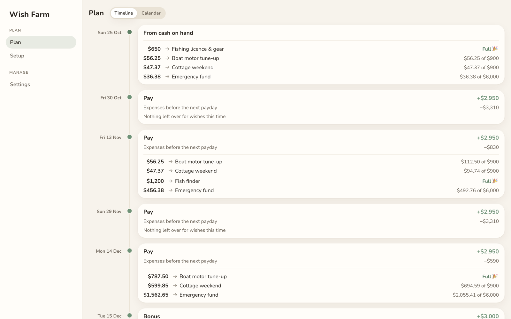
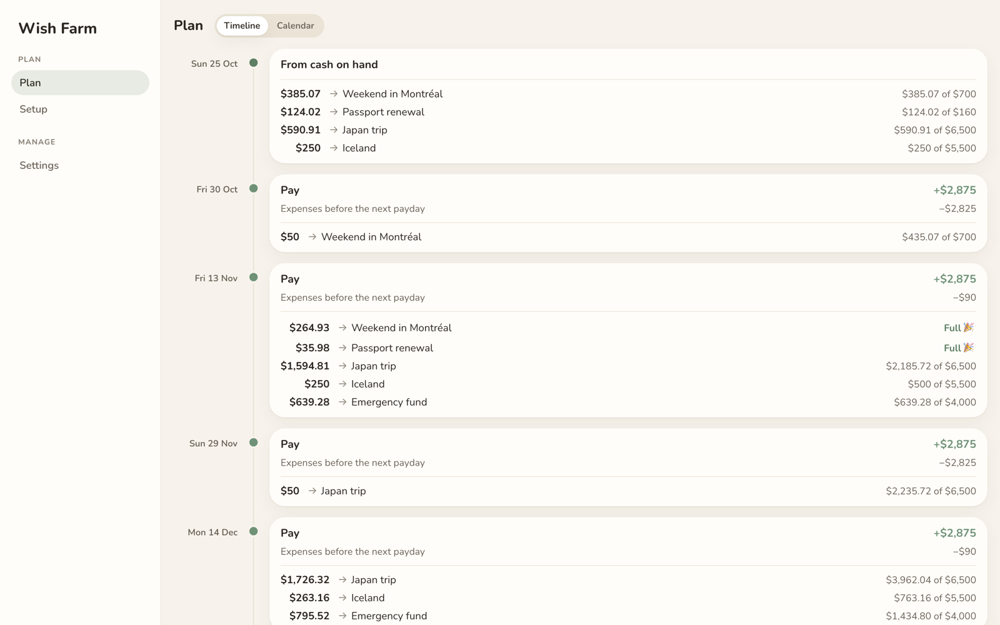

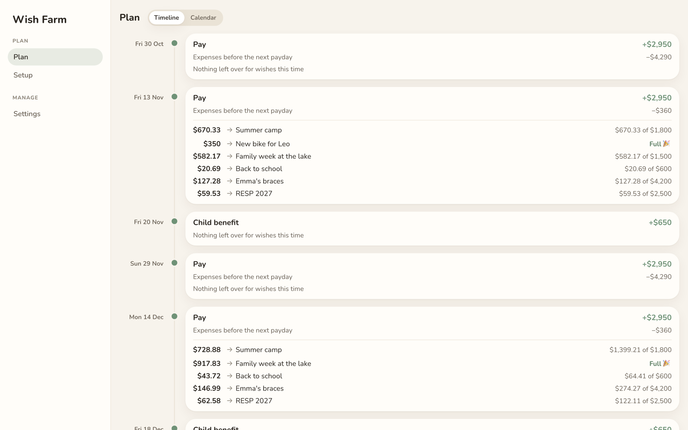
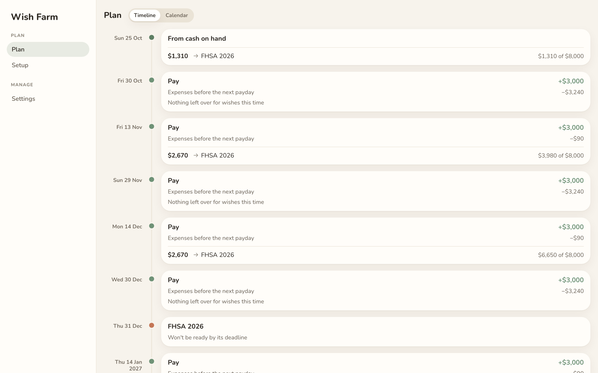

Marcus's plan also shows a warning. His FHSA 2026 can't be full by December 31 while he's also paying for a ring, so Wish Farm says so up front, and he can decide what gives.

## A tour

**The timeline** is the main view. Each payday shows what came in, what the bills will take before the next one, and where every remaining dollar goes, with each wish's balance after. "Full 🎉" is when you get to buy the thing.

**When a debt ends,** the timeline says what it frees up. From then on, that payment goes to your wishes.

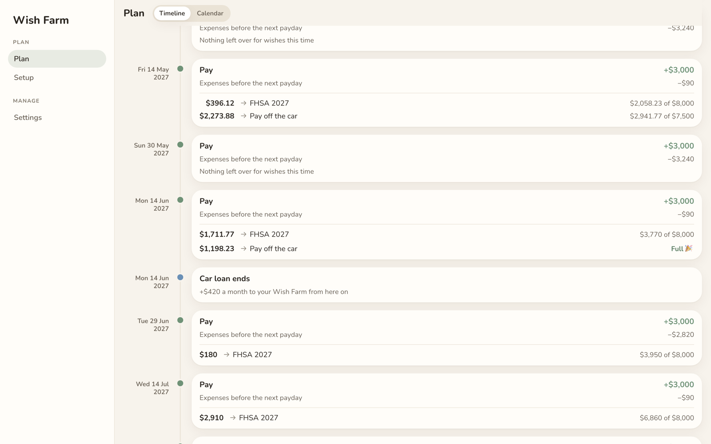

**The calendar** shows the same plan by month, with each month's money in, money out, and what went to wishes.

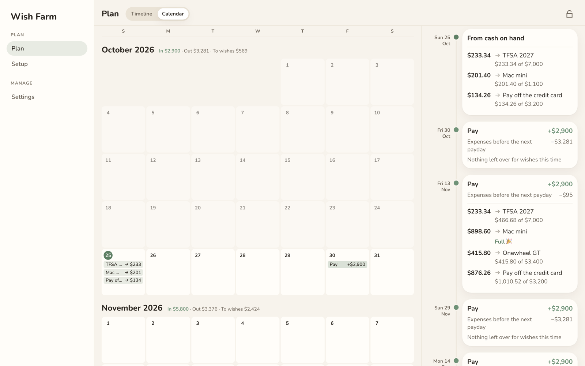

**On a phone,** the same plan fits one column. Tap a day on the calendar to see what happens that day.

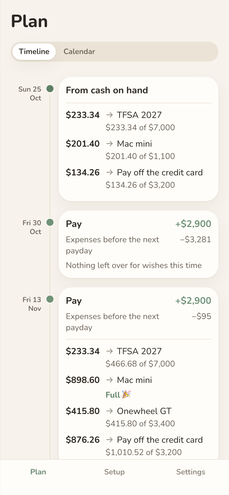
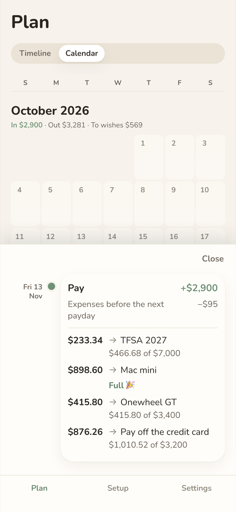

**Setup** is where your cash, income and expenses live. If you connect YNAB, these fill themselves in.

**Settings** has the two dials: how much of each payday goes to treats, and how much savings can lend to finish a treat early.

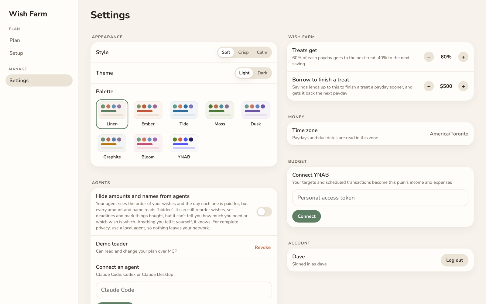

## When life happens

The plan isn't a promise. It's recalculated from what actually happened, every hour.

**Dave overspends.** He planned to start his Mac mini with the $1,200 he had on hand. Then a weekend away cost $1,800 more than he budgeted, so he's $600 short.

| Before | After |
|---|---|
| 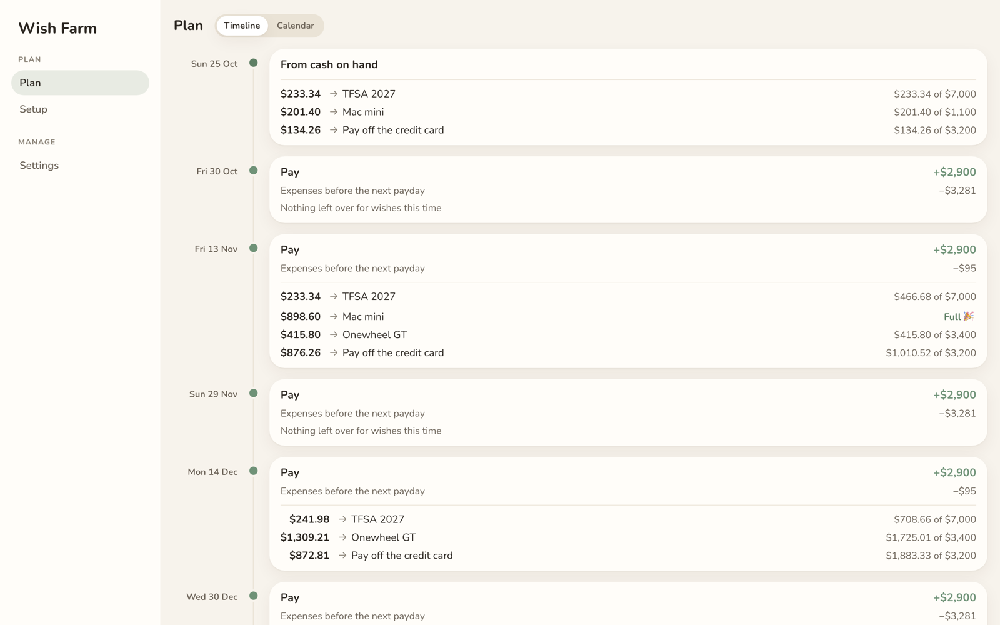 | 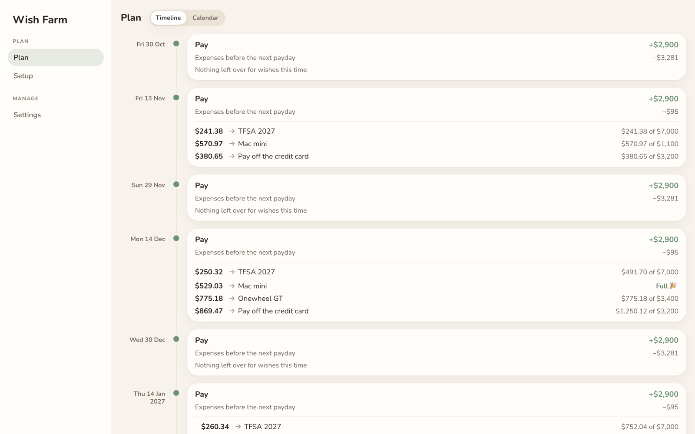 |
| His $1,200 goes straight to three wishes. The Mac mini is paid for on **Nov 13**. | The next paycheque fills the $600 hole first. The Mac mini moves to **Dec 14**, and everything after it shifts a little. |

Nobody had to edit anything. With YNAB connected, the overspending shows up in YNAB and Wish Farm sees it on its next refresh.

It works the other way too:

- **You sell something on Marketplace.** The money lands in Ready to Assign, and Wish Farm puts it toward your next wishes within the hour. Nothing has to be scheduled.
- **You assign extra to a wish yourself.** It counts as saved, and that wish arrives sooner.
- **You pull money out of a wish for the vet.** It stops counting, and that wish's date moves out.

## How it works with YNAB

You connect Wish Farm with a YNAB personal access token (YNAB → Account Settings → Developer Settings). The token is stored encrypted. From then on, Wish Farm refreshes every hour (you can change how often).

**What it reads from YNAB**

- **Income:** your scheduled inflows (your paycheque, a monthly benefit).
- **Expenses:** your scheduled outflows. Categories with a target but no scheduled transaction are added up into one monthly expense.
- **Cash:** Ready to Assign, less any overspending you haven't covered yet. If you're overspent, the next paycheque covers that before any wish gets money.
- **What you've saved toward each wish:** each category in your **Wish Farm** group whose name matches a wish. Everything assigned to that category since the wish started counts, even money you've since moved out *toward* the wish. For example, $5,000 moved into an FHSA account still counts as $5,000 saved toward the FHSA.

**What it changes in YNAB**

- **Targets, this month only.** Each wish Wish Farm is funding this month gets a "set aside another $X" target for exactly what the plan puts in this month. It's added on top of anything you've already assigned to it this month. Every other wish's target is cleared. When the plan moves on to the next wish, its target appears and the last one's is removed. Here is what Sally's October looks like:

  | Category (Wish Farm group) | Target this month |
  |---|---|
  | Weekend in Montréal | $435.07 |
  | Passport renewal | $124.02 |
  | Japan trip | $590.91 |
  | Iceland | $250.00 |
  | Emergency fund, New carry-on | no target this month |

- **Finished debts.** When a debt you've told Wish Farm about is paid off, it moves that category into your **Wish Farm Complete** group and deletes the debt's recurring scheduled transaction.
- **Nothing else.** It never adds scheduled transactions, and it never touches categories, targets or transactions outside what's listed here.

**Coming soon:** when you buy a wish, Wish Farm will be able to move the purchase out of the wish's category into one you choose (say, Discretionary), then archive the empty category so you can delete it.

**Safe to repeat.** Every hourly update is worked out fresh: read YNAB, compare it with the plan, change only what differs, then read again to confirm. If YNAB is busy or a request gets no answer, it tries again later without doing anything twice.

### Setting up your budget for it

Make three category groups in YNAB:

- **Wish Farm:** one category per wish, named the same as the wish.
- **Wish List:** wishes you're thinking about but haven't committed to.
- **Wish Farm Complete:** where finished wishes and paid-off debts go.

## Running it

Wish Farm runs as a single small server with its own database, in your browser on desktop and phone. It works without YNAB too: you enter your income and expenses in Setup yourself. You can sign in with a username and password, or with your own single sign-on.

It isn't published yet. When it is, this README will say how to run it.
