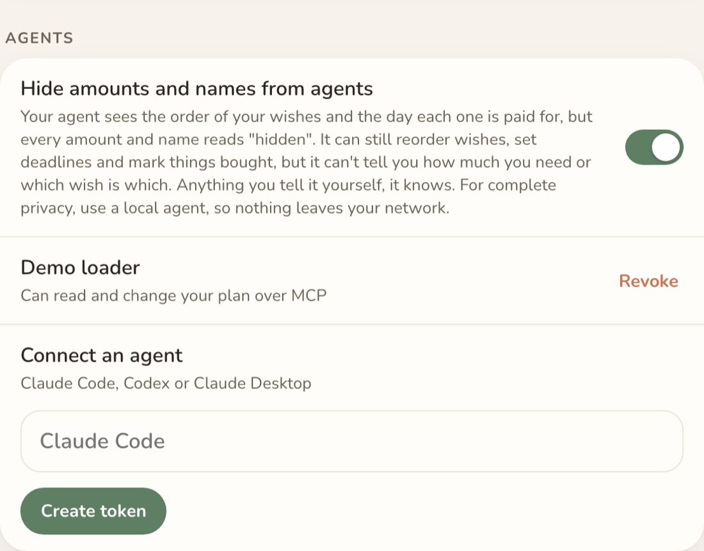

# Keep your numbers from agents

[← Back](12.md) &nbsp;·&nbsp; 13 of 13 &nbsp;·&nbsp; [Back to the README →](../../README.md)

One switch in Settings, and every amount and name an agent gets back reads "hidden". It still sees the order of your wishes and the day each one is paid for, so it can reorder, set deadlines and mark things bought, but it can't tell you how much or which is which. The browser and YNAB keep the real numbers. For complete privacy, use a local agent.

[← Back](12.md) &nbsp;·&nbsp; 13 of 13 &nbsp;·&nbsp; [Back to the README →](../../README.md)
